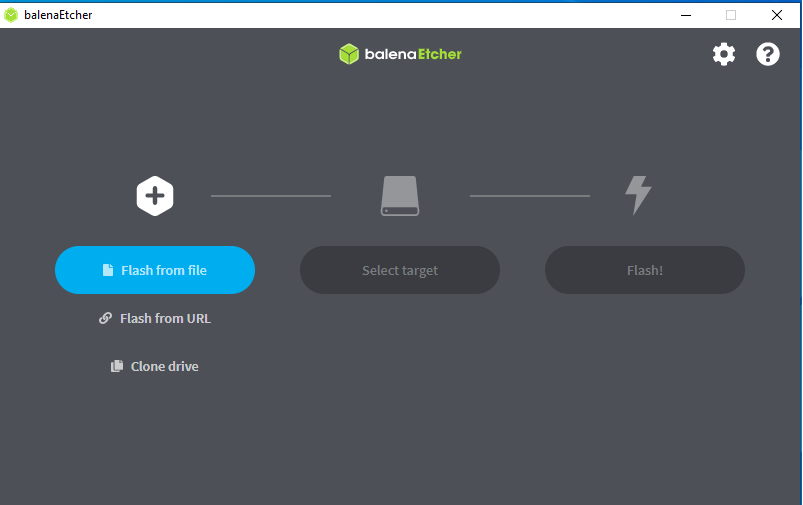

[**Back to tBOX210 BSP**](../README.md)

---


# tBOX210

* [Set Up the Build Environment](#set-up-the-build-environment)
* [Download the Project](#download-the-project)
* [Build Commands](#build-commands)
* [Boot from a USB Flash Drive](#boot-from-a-usb-flash-drive)
    - [Disk Image](#disk-image)
    - [Use the `balenaEtcher` Tool](#use-the-balenaetcher-tool)
* [Boot from an NVMe Drive](#boot-from-an-nvme-drive)

---

## Set Up the Build Environment


<div align="right">

[**Back to Top**](#tbox210)

</div>
 


Source the QNX SDP environment script before building the BSP:

```console
$ source ~/qnx805/qnxsdp-env.sh
QNX_HOST=$HOME/qnx805/host/linux/x86_64
QNX_TARGET=$HOME/qnx805/target/qnx
MAKEFLAGS=-I$HOME/qnx805/target/qnx/usr/include
```

<div align="right">

[**Back to Top**](#tbox210)

</div>
 

---


## Download the Project


<div align="right">

[**Back to Top**](#tbox210)

</div>


Clone the repository and use Git sparse checkout to retrieve only the tBOX210 BSP source:

```text
$ cd ~
$ git clone -b tbox210 --single-branch git@github.com:axiomtek-usa/bsp-axiomtek-x86_64_qnx.git tBOX210
```

The tBOX210 BSP source files will be available at:

```text
~/tBOX210/
```


<div align="right">

[**Back to Top**](#tbox210)

</div>

 ---

## Build Commands

<div align="right">

[**Back to Top**](#tbox210)

</div>


Change to the tBOX210 BSP directory and build the project:

```console
$ cd ~/tBOX210/
$ make clean
$ make
```

Locate the generated bootable image

```
$ ls -lh images/disk_tbox210-805.img
```


<div align="right">

[**Back to Top**](#tbox210)

</div>

 
---


## Boot from a USB Flash Drive


<div align="right">

[**Back to Top**](#tbox210)

</div>


### Disk Image

<div align="right">

[**Back to Top**](#tbox210)

</div>


The build generates the following disk image:

| Name | Graphics | Legacy BIOS Boot | UEFI Boot |
| :------: | :------: | :---------------: | :-------: |
| `disk_tbox210-805.img` | **Yes** | **No** | **Yes** |


<div align="right">

[**Back to Top**](#tbox210)

</div>
 
 
### Use the `balenaEtcher` Tool

<div align="right">

[**Back to Top**](#tbox210)

</div>


Download and install the [`balenaEtcher`](https://etcher.balena.io/) tool.

Use `balenaEtcher` to write the QNX disk image to a USB flash drive.




<div align="right">

[**Back to Top**](#tbox210)

</div>
 
---


## Boot from an NVMe Drive


<div align="right">

[**Back to Top**](#tbox210)

</div>


After booting the tBOX210 from the USB flash drive, use the `dd` command to copy the disk image from the USB device to the NVMe drive:

```console
# dd if=/dev/umass0 of=/dev/nvme0 count=1642496
1642496+0 records in
1642496+0 records out
840957952 bytes (802 M) copied, 27.491 s, 29 M/s
```
After the copy operation completes:

1. Power off the system.
2. Remove the USB flash drive.
3. Power on the tBOX210.
4. The system should boot from the NVMe drive.

> **Note:**
 
The image size is based on:
```text
512 bytes x 1,642,496 = 802 MiB
```


<div align="right">

[**Back to Top**](#tbox210)

</div>
 
---

[**Back to tBOX210 BSP**](../README.md)


